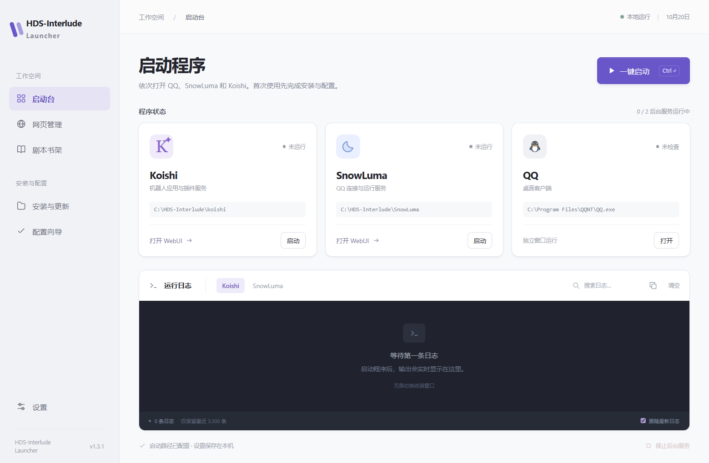
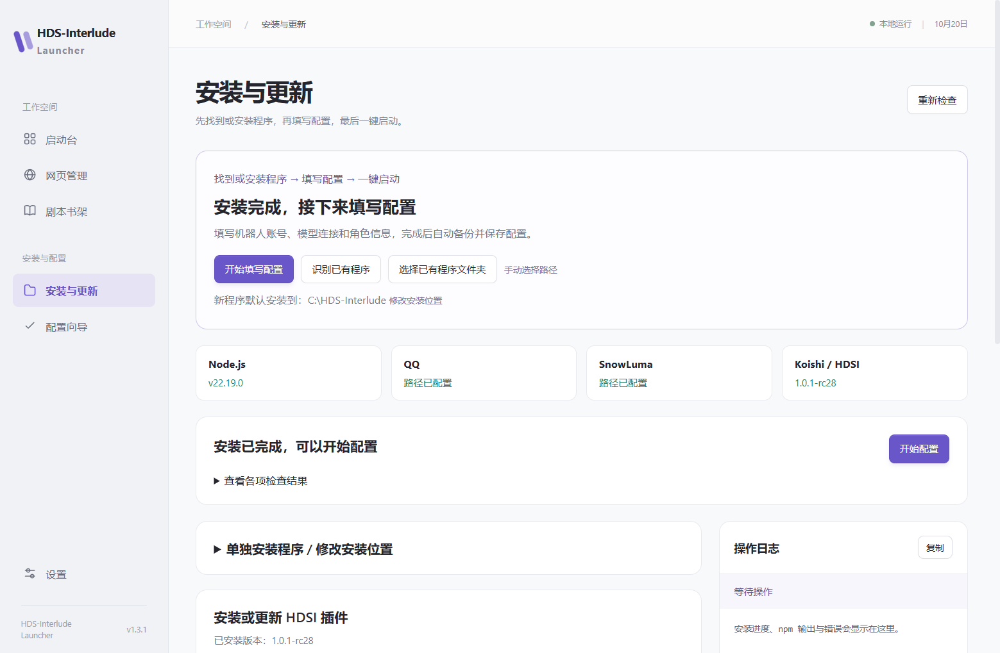
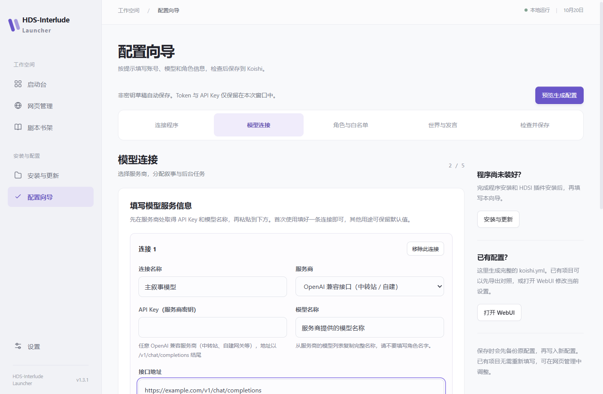
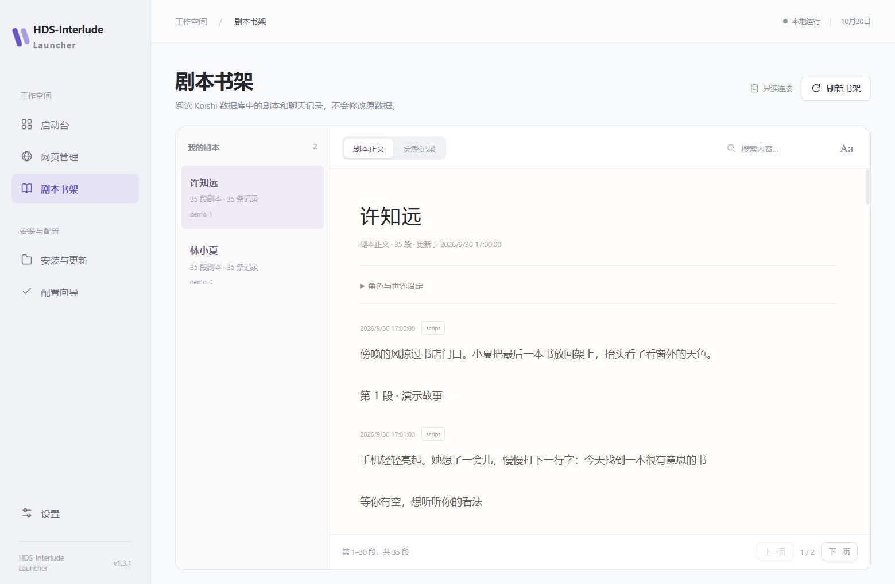
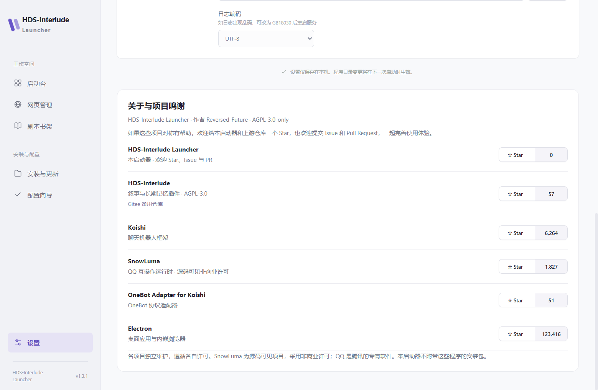

# HDS-Interlude Launcher

把 Koishi、SnowLuma 和 QQ 的启动、安装、配置、日志与剧本阅读放进一个 Windows 桌面窗口。

[](https://github.com/Reversed-Future/HDS-Interlude-Launcher/stargazers)
[](https://github.com/Reversed-Future/HDS-Interlude-Launcher/releases/latest)
[](LICENSE)

**[下载最新版本](https://github.com/Reversed-Future/HDS-Interlude-Launcher/releases/latest)** · [反馈问题](https://github.com/Reversed-Future/HDS-Interlude-Launcher/issues) · [参与开发](CONTRIBUTING.md)

如果启动器对你有帮助，欢迎点一个 **Star**！也请给下方的上游项目 Star，支持这些功能背后的维护者。欢迎提交 Issue 和 Pull Request。

## 看看界面

截图来自实际桌面应用，账号、路径和剧本均为演示数据。



| 安装与应用内更新                          | 原生分步配置                                    |
| ----------------------------------------- | ----------------------------------------------- |
|  |  |
| 剧本书架                                  | 项目鸣谢与 Star 星数                            |
|   |              |

## 能做什么

- **一键启动**：依次发起 QQ、SnowLuma、Koishi 的启动请求。Koishi 在配置目录执行 `npm run start`；SnowLuma 在配置目录运行 `launcher.bat`。
- **内置日志**：切换查看两个后台服务的标准输出和错误输出，支持搜索、复制、清空和跟随。启动器不弹出 PowerShell 日志窗口。
- **内嵌 WebUI**：独立 Chromium 视图打开两个管理页面，保留本机登录状态，支持通常不允许 iframe 嵌入的页面。
- **安装与检查**：Node.js LTS、QQ 官方安装包、SnowLuma 官方完整包、Koishi 脚手架，以及 HDSI 所需插件。
- **HDSI 更新**：检查 npm `beta` 通道，或拖入本地 `.tgz`。显示真实包版本，安装前备份配置和依赖清单。
- **配置向导**：连接程序 → 模型连接 → 角色与白名单 → 世界与发言 → 检查并保存。依据 rc28 教程重做原生界面。
- **剧本书架**：只读访问 `koishi.db`，支持正文/完整记录、搜索、分页和字号调整；`<sep/>` 显示为角色分条发送的段落。
- **启动器更新**：启动后检查本仓库 Release，在软件内下载、校验并重启到新版本。
- **关于与鸣谢**：列出本项目和相关仓库，显示 GitHub / Gitee Star 数量，点击即可访问仓库。

## 开始使用

适用于 **Windows x64**。下载 Release 中的 `HDS-Interlude-Launcher-版本号-win-x64.zip`，完整解压后打开 `HDS-Interlude Launcher.exe`。请保留同目录的运行库，不能只移动 EXE。

启动器自带 Electron 运行环境；运行 Koishi 和 SnowLuma 仍需要本机 Node.js/npm。首次打开不会预填维护者的程序路径。

### 路径能自动识别到什么程度？

| 项目                       | 行为                                                                                            |
| -------------------------- | ----------------------------------------------------------------------------------------------- |
| 新安装的 Koishi / SnowLuma | 安装成功后自动保存实际目录；默认父目录是系统「文档」下的 `HDS-Interlude`，也可自行选择          |
| 已安装的 QQ                | 「设置 → 自动识别路径」读取正在运行的 QQ 进程和安装注册表，验证实际 `QQ.exe`                    |
| 已有 Koishi / SnowLuma     | 检查默认安装目录、启动器附近和已配置目录；也可「选择父目录扫描」，最多向下两层、检查 400 个目录 |
| 剧本数据库                 | 识别已找到的 Koishi 项目下真实存在的 `data/koishi.db`；其他位置可手动选择                       |
| WebUI                      | 地址请按各程序实际配置或启动日志填写；自定义端口不会被推断                                      |

找到唯一位置时只填入空白项；已有设置不会被自动覆盖。找到多处安装时由你选择，核对后点击保存。任意磁盘位置、尚未生成的数据库和自定义文件名不能保证自动识别。

首次打开时直接进入安装页面。顶部会根据检查结果给出下一步按钮；已有程序先点击「识别已有程序」或「选择已有程序文件夹」，唯一识别结果会保存到本机。路径未选择时明确显示尚未选择，不再列成插件全部缺失。已有配置的用户可直接前往启动台。

### 安装顺序

1. 打开「安装与更新」，检测本机环境。缺少 Node.js 时点击安装 LTS，执行 `winget install -e --id OpenJS.NodeJS.LTS`，附加接受协议和禁用终端交互参数。结束后重新读取系统与用户 PATH，再检测 Node.js/npm；通常无需重启电脑。若仍未检测到，先重新打开启动器；仅在安装器要求时重启电脑。未安装 winget 时可打开 Node.js 官网手动安装。
2. 点击 QQ 官方下载安装。程序获取官网当前版本的下载地址和签名，下载后验证 Windows 数字签名，再打开官方安装窗口。安装向导和 QQ 登录需要你完成；之后在设置中识别或选择 QQ.exe。
3. 选择父目录和新目录名，安装 SnowLuma。读取官方 Release 中明确列出的 Windows x64 完整 ZIP，验证官方 SHA-256，解压到新目录；也支持导入本地 ZIP。
4. 选择 Koishi 安装位置。运行已核实的 `create-koishi@6.4.0` 脚手架，再安装项目依赖并保存路径。
5. 安装 HDSI：在线检查 `beta` 后安装，或拖入官方 `.tgz`。每次安装 HDSI 前，先补齐 21 个 Console 管理模块、`koishi-plugin-adapter-onebot` 和 `@koishijs/plugin-database-sqlite`；任一步失败就停止。
6. **全部安装检查通过后才能配置。** 检查覆盖 Node.js/npm、QQ、SnowLuma、Koishi 运行依赖、Console 模块、OneBot、SQLite 和 HDSI。向导入口、导出及写入都会检查。

官方来源：[Koishi 脚手架说明](https://koishi.chat/zh-CN/manual/starter/boilerplate.html)、[SnowLuma Releases](https://github.com/SnowLuma/SnowLuma/releases)、[QQ 官网](https://im.qq.com/pc/)、[HDS-Interlude Releases](https://github.com/ISEKAI-MomoiCore/HDS-Interlude/releases)。

### 配置、备份与表情包

配置向导面向新项目，依据 HDS-Interlude 的 `新人上手一条龙配置服务v1.0.1-rc28.html` 生成**完整** `koishi.yml`，不会合并既有插件配置。已有项目可用内嵌 Koishi WebUI 修改。

预览后点击「备份并写入 Koishi」：旧文件备份为根目录 `koishi.yml.bak`，再写入生成内容。已有 `.bak` 会先保留到 `.hds-launcher-backups`；备份失败则不替换原配置。原文件不存在时直接创建。

**Embedding 必须使用专用的文本向量模型，并且此连接只能承担 Embedding。** 勾选后其他用途会取消并禁用，聊天与叙事请另建连接。字段遵循 rc28 插件实际逻辑：填写 `/chat/completions` 地址，由插件派生 `/embeddings`；模型必须由服务商确认支持向量接口。

启用「本地表情包库」后，可直接创建并打开 `<Koishi目录>/data/hds-interlude/stickers` 来放入素材；保存时也会创建缺失目录。关闭该选项不会删除素材。另需给支持识图的模型启用「表情包描述」。

插件发布页默认使用 [GitHub](https://github.com/ISEKAI-MomoiCore/HDS-Interlude/releases)，保留 [Gitee 备用入口](https://gitee.com/MomoiCore/hds-interlude/releases)。GitHub 发布列表无法获取时自动尝试 Gitee，页面标明实际来源。

### 两种插件更新方式

- **npm beta**：执行 `npm view koishi-plugin-hds-interlude dist-tags --json`，将 `beta` 与本地包版本比较。确认安装后使用 `npm install --save-exact koishi-plugin-hds-interlude@已检查版本`，锁定页面展示的版本。
- **本地包**：拖入 `.tgz`，校验包名、版本及 SHA-256，在 Koishi 根目录执行 `npm install --save-exact "安装包完整路径"`。较旧版本会先提示降级确认。

更新前请停止 Koishi。安装器将 `package.json`、存在的锁文件和 `koishi.yml` 备份到 `.hds-launcher-backups`。这不是数据库快照或自动回滚；npm 中途失败可能留下部分依赖变更，可查看内置日志后重试。

### 启动器自动更新

启动后会检查本仓库最新正式 Release；遇到网络错误或 HTTP 403/429 时，在隔离会话中自动重试直连 GitHub，不修改 WebUI 或系统代理；仍然失败时显示处理办法。

也可在「安装与更新 → 启动器更新」手动检查。发现更新后点击「下载并准备更新」，校验 SHA-256 和文件大小，停止后台服务，再点击重启更新。

新版本安装在 `%APPDATA%\InterludeLauncher\versions` 的独立目录，配置保留。旧版本文件和下载不会自动删除。从支持此机制的旧启动入口打开时，会自动转到已启用的新版本。关闭软件前未点击重启启用的更新，下次需要重新下载准备。无网络或 GitHub 限流时仍可正常使用本地功能，也可手动下载 Release。

Release 标题采用 **`HDS-Interlude-Launcher-1.3.1`** 格式；Git 标签为 `v1.3.1`。`launcher-update.json` 和 `SHA256SUMS.txt` 是更新清单及校验文件，普通用户只需下载 ZIP。

## 数据与运行说明

- 设置位于 `%APPDATA%\InterludeLauncher\settings.json`。向导草稿不保存 API Key / Token；生成的 YAML 本身包含凭据，请妥善保存。
- 剧本读取使用 SQLite 只读模式，支持 WAL；依赖 `interlude_story` / `interlude_script_entry` 实际表结构。不兼容的数据库会提示错误。
- 「运行中」表示进程仍在运行，不代表 QQ 已登录、SnowLuma 已注入或模型 API 已连接；这些状态请看日志和 WebUI。
- 启动器只接管自己启动的后台进程；不能追溯外部进程的日志。停止全部会结束受管理的 Koishi / SnowLuma 进程树，QQ 保持打开。
- 程序日志每个服务保留最近 3,000 条，界面显示最新 600 条；安装日志保留 2,500 行。关闭后内存日志清空。乱码可切换 GB18030 / GBK 后重启服务。
- 下载、失败的 `.part`、旧版本和备份均保留，按需手动清理。下载和安装不会绕过 Windows 安装窗口或 UAC。
- 快捷键：`Ctrl+Enter` 一键启动；`Alt+1/2/3/4` 切换启动台、WebUI、书架、设置；`Esc` 关闭提示。
- Star 数量从公开仓库接口读取，缓存一小时。网络失败显示上次数字，没有缓存时显示「—」。点击 Star 按钮打开仓库，是否收藏由你在 GitHub / Gitee 上决定。

## 开源与相关项目

感谢这些项目。欢迎访问仓库、了解各自许可，并给喜欢的项目一个 **Star**。

| 项目                                                                                | 用途                             | Star                                                                                                                                                                |
| ----------------------------------------------------------------------------------- | -------------------------------- | ------------------------------------------------------------------------------------------------------------------------------------------------------------------- |
| [HDS-Interlude Launcher](https://github.com/Reversed-Future/HDS-Interlude-Launcher) | 本启动器                         | [](https://github.com/Reversed-Future/HDS-Interlude-Launcher) |
| [HDS-Interlude](https://github.com/ISEKAI-MomoiCore/HDS-Interlude)                  | 叙事与长期记忆插件、配置生成参考 | [前往 GitHub Star](https://github.com/ISEKAI-MomoiCore/HDS-Interlude)                                                                                               |
| [Koishi](https://github.com/koishijs/koishi)                                        | 聊天机器人框架                   | [](https://github.com/koishijs/koishi)                                               |
| [SnowLuma](https://github.com/SnowLuma/SnowLuma)                                    | QQ 互操作运行时                  | [](https://github.com/SnowLuma/SnowLuma)                                           |
| [OneBot Adapter](https://github.com/koishijs/koishi-plugin-adapter-onebot)          | Koishi 与 SnowLuma 消息适配      | [](https://github.com/koishijs/koishi-plugin-adapter-onebot)   |
| [Electron](https://github.com/electron/electron)                                    | 桌面运行时与内嵌浏览器           | [](https://github.com/electron/electron)                                           |

启动器按 [AGPL-3.0-only](LICENSE) 发布。配置生成逻辑改编自 HDS-Interlude rc28 教程，来源与依赖说明见 [THIRD_PARTY_NOTICES.md](THIRD_PARTY_NOTICES.md)。SnowLuma 为源码可见、非商业许可项目；QQ 是腾讯的专有软件，均独立分发，启动器不附带这些程序的安装包。各项目名称归各自维护者所有。

## 参与开发

在 Windows 上使用 Node.js 22.13+ 和 npm：

```powershell
npm ci
npm start
npm test
npm run test:desktop
npm run package
node scripts/smoke-package.cjs
npm run release:assets
npm run test:updater
```

测试使用独立配置和合成数据库，不读取开发者的聊天记录。桌面安装测试会访问 npm 与官方下载端点，并仅在测试目录安装依赖。打包每次产生新目录，不清理旧输出。发布包不包含 `local-settings.json`、测试资料或参考文档原件。

`src/` 管理进程、日志、配置、SQLite 和内嵌网页；`src/setup/` 处理安装与配置；`src/update/` 处理启动器更新；`ui/` 按页面拆分。UI 提供明确的焦点、即时操作反馈，以及减少动态效果支持。

发现问题请提交 [Issue](https://github.com/Reversed-Future/HDS-Interlude-Launcher/issues)，附上版本、复现步骤和去除凭据的日志。改进功能欢迎 [PR](https://github.com/Reversed-Future/HDS-Interlude-Launcher/pulls)，具体流程见 [贡献指南](CONTRIBUTING.md)。
